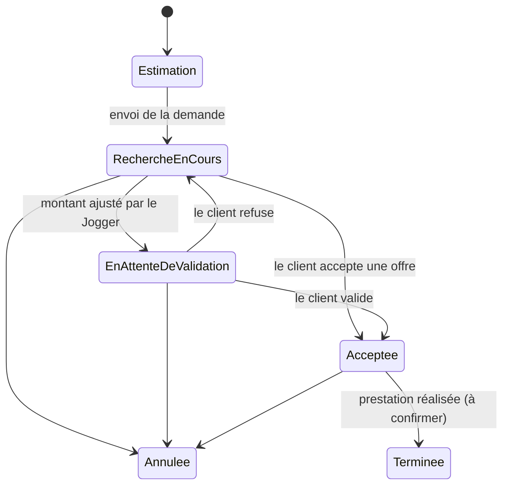

# Architecture fonctionnelle — Jojo Client

Jojo Client est l'application mobile (Flutter) qui permet à un particulier ou un professionnel de commander un service de manutention ou de transport, de comparer les offres des Joggers, puis d'échanger avec celui qu'il a retenu.

## Acteurs

| Acteur | Rôle |
| --- | --- |
| Client | Particulier ou professionnel. Décrit son besoin, reçoit une estimation, choisit une offre, discute avec le Jogger. |
| Jogger | Prestataire (appelé aussi « jobber »). Répond aux demandes par une offre, conduit le camion. |
| Gros Bras | Manutentionnaire qui porte, charge et décharge. |
| Back-office Jojo | Publie les paramètres tarifaires, suit les demandes, traite les devis. |

## Services

| Service | Parcours | Particularités |
| --- | --- | --- |
| Transport | Parcours complet (10 écrans, page « Commande ») | Un objet ou quelques meubles ; camion 12 ou 20 m³ ; le client peut charger lui-même. |
| Déménagement | Même parcours que le Transport (page « Déménagement ») | Volume par liste ou par surface ; Gros Bras proposés par défaut ; minimum de chargement 1 h (12 m³) ou 1 h 30 (20 m³). |
| Gros bras | Parcours dédié (7 écrans, page « Gros bras ») | Sans camion ; mission (charger, décharger, monter, déplacer) ; pas de stationnement ; charge lourde. |
| Groupage | À concevoir | Sur devis (prestation au forfait). |
| Remorquage | À concevoir | Absent de la grille tarifaire. |

## Domaines fonctionnels

| Domaine | Ce qu'il couvre | Écrans |
| --- | --- | --- |
| Découverte | Carte, position du client, choix du service | 1 Accueil, 2 Choix du service |
| Commande | Adresses, affaires, accès, date, proposition, récapitulatif, envoi | 3 à 10 ; D3 à D10 ; G1 à G7 |
| Estimation | Calcul du prix en direct, détail ligne par ligne | 8 Proposition, D8, G5 |
| Offres | Réception, classement, détail, acceptation ou rejet | 12 Détail en recherche |
| Suivi | Liste et détail des demandes par statut | 11 à 15 |
| Messagerie | Discussion client ↔ Jogger après acceptation | 16 Messages, 17 Discussion |
| Profil | Compte, profil Particulier / Professionnel | À concevoir |

## Cycle de vie d'une demande

| Statut affiché | Code | Messagerie | Actions du client |
| --- | --- | --- | --- |
| Recherche en cours | `searching` | fermée | voir les offres, accepter, rejeter, modifier, annuler |
| En attente de validation | `awaiting_validation` | fermée | valider ou refuser le montant, annuler |
| Acceptée | `accepted` | ouverte | discuter, appeler, annuler |
| Annulée | `cancelled` | lecture seule | refaire la demande |
| Terminée (à confirmer) | `completed` | lecture seule | noter, refaire |

La définition machine des statuts et transitions est dans `04-configuration/request-states.json`.

## Règles structurantes

- Le prix est **toujours** calculé par le serveur à partir d'une version de paramètres publiée ; l'app affiche le résultat et le détail.
- Une estimation n'est pas un devis : le montant est confirmé par l'offre acceptée.
- Plusieurs Joggers peuvent faire une offre sur une demande ; dès qu'une offre est acceptée, les autres sont clôturées et ne sont plus consultables.
- La discussion s'ouvre à l'acceptation, dans l'onglet Messages, et passe en lecture seule si la demande est annulée.
