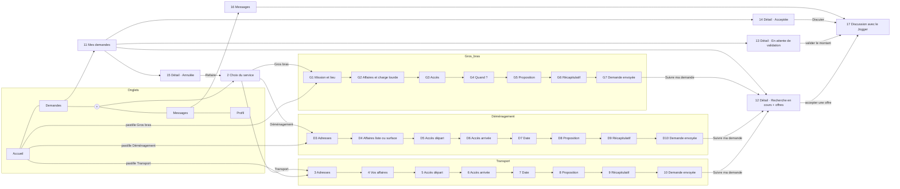

# Architecture de navigation

L'app tient en 5 onglets. Le bouton central (+) et les pastilles de l'Accueil ouvrent le parcours de commande du service choisi ; la demande envoyée apparaît dans l'onglet Demandes ; une offre acceptée ouvre une discussion dans l'onglet Messages.

## Menu du bas

| Onglet | Écran racine | Rôle |
| --- | --- | --- |
| Accueil | 1 Accueil | Carte centrée sur la position du client (si aucune demande en cours), pastilles des 5 services |
| Demandes | 11 Mes demandes | Liste filtrable par statut |
| (+) | 2 Choix du service | Démarrer une nouvelle demande |
| Messages | 16 Messages | Discussions des demandes acceptées |
| Profil | À concevoir | Compte, profil, préférences |

## Carte de navigation

## Inventaire des écrans

| # | Écran | Fichier | Ouvert depuis | Mène vers |
| --- | --- | --- | --- | --- |
| 1 | Accueil | `Main` | onglet Accueil | parcours du service, Demandes, Messages |
| 2 | Choix du service | `NouvelleDemande` | bouton (+) | 3, D3 ou G1 |
| 3 | Les adresses (+ escale) | `Adresses` | 1, 2 | 4 |
| 4 | Vos affaires | `Affaires` | 3 | 5 |
| 5 | Accès au départ | `AccesDepart` | 4 | 6 |
| 6 | Accès à l'arrivée | `AccesArrivee` | 5 | 7 |
| 7 | La date | `Date` | 6 | 8 |
| 8 | Votre proposition | `Proposition` | 7 | 9 |
| 9 | Récapitulatif | `Recap` | 8 | 10 |
| 10 | Demande envoyée | `Confirmation` | 9 | 12, Accueil |
| D3–D10 | Parcours Déménagement | `Dem*` | 1, 2 | idem Transport |
| G1–G7 | Parcours Gros bras | `GB*` | 1, 2 | G2 → G7, puis 12 |
| 11 | Mes demandes | `Demandes` | onglet Demandes | 12 à 15 |
| 12 | Détail · Recherche en cours (offres) | `DetailRecherche` | 11, 10 | 17 après acceptation |
| 13 | Détail · En attente de validation | `DetailAttente` | 11 | 17 après validation |
| 14 | Détail · Acceptée | `DetailAcceptee` | 11 | 17 |
| 15 | Détail · Annulée | `DetailAnnulee` | 11 | 2 |
| 16 | Messages | `Messages` | onglet Messages | 17 |
| 17 | Discussion avec le Jogger | `Conversation` | 16, 14 | 14 |

## Conventions de navigation

- **Parcours de commande** : plein écran, sans menu du bas ; flèche retour en haut à gauche, croix pour quitter (retour à l'Accueil, brouillon conservé), bouton d'action fixé en bas.
- **Progression** : barre en 5 segments et libellé « Étape X sur 5 · <étape> » ; des puces récapitulent les choix déjà faits (service, distance, volume, équipe).
- **Écrans longs** : le contenu défile, l'en-tête et le bouton d'action restent fixes.
- **Liens profonds proposés** : `jojo://request/{id}`, `jojo://request/{id}/offers`, `jojo://conversation/{id}` (notifications d'offre reçue, d'acceptation et de message).

## Routes Flutter suggérées (go_router)

| Route | Écran |
| --- | --- |
| `/` | Accueil (ShellRoute avec menu du bas) |
| `/requests`, `/requests/:id` | Mes demandes, détail selon le statut |
| `/messages`, `/messages/:conversationId` | Messages, discussion |
| `/profile` | Profil |
| `/new` | Choix du service |
| `/new/:service/:step` | Étapes du parcours (`transport`, `demenagement`, `gros_bras`) |
| `/new/:service/summary`, `/new/:service/sent/:id` | Récapitulatif, demande envoyée |
