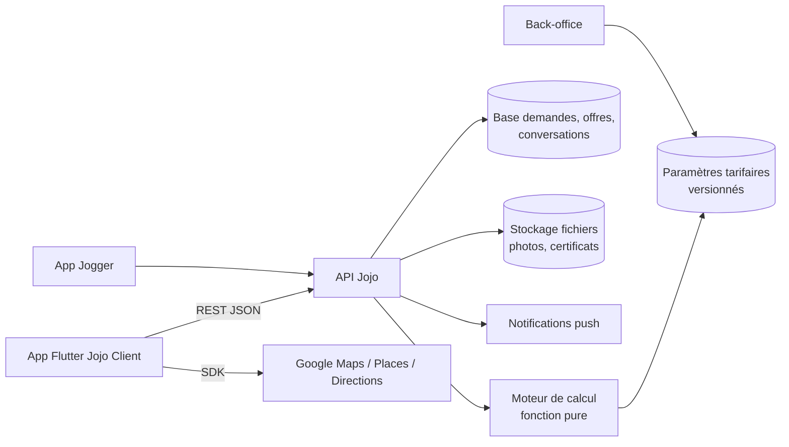

# Architecture technique

## Vue d'ensemble



| Composant | Responsabilité |
| --- | --- |
| App Flutter | Saisie du parcours, affichage de l'estimation en direct (appel `POST /quotes/estimate` à chaque changement), suivi, messagerie. |
| API | Valide les entrées, appelle le moteur, persiste les demandes et les offres, applique les transitions de `request-states.json`. |
| Moteur de calcul | `estimate(input, config)` → total, lignes, alertes, `configVersion`. Aucune I/O. Référence JS dans `05-moteur-de-calcul/js`, portage Dart dans `05-moteur-de-calcul/dart`. |
| Paramètres | `pricing-config.json` : formules, paliers, matrice, modificateurs, politiques. Une version active par date d'effet. |
| Back-office | Édite et publie une version de paramètres, traite les devis (> 20 m³, Groupage, montage, débarras). |

**Prix faisant foi** : toujours celui du serveur. Le portage Dart sert à l'affichage hors ligne et aux tests ; l'app recalcule côté serveur avant l'envoi.

## Modèle de données

| Entité | Champs principaux |
| --- | --- |
| `Request` | id, clientId, service (`transport`, `demenagement`, `gros_bras`, `groupage`, `remorquage`), status, addresses[], stopover?, items[], volumeM3, truck, helpers, heavyItem?, accesses[], startAt, hoursBooked, estimate, configVersion, createdAt |
| `Address` | role (`departure`, `stopover`, `arrival`, `site`), label, lat, lng, postcode, floor, lift, liftFitsFurniture, carryDistanceM, parking (`yes`, `no`, `unknown`), parkingCertificateFileId?, accessNotes |
| `ItemLine` | catalogItemId, label, qty, unitVolumeM3, bulky, heavy, special, photoFileIds[] |
| `Mission` (Gros bras) | type (`load`, `unload`, `carry_floors`, `move_onsite`), siteAddress, secondAddress?, startAt |
| `Estimate` | formula, tier, total, lines[] (code, label, amount), onSiteHours, kmIncluded, warnings[], configVersion |
| `Offer` | id, requestId, joggerId, price, truck, arrivalAt, message, status (`open`, `accepted`, `rejected`, `closed`), score |
| `Jogger` | id, displayName, rating, reviewsCount, onTimeRate, completedJobs, vehicle |
| `Conversation` | id, requestId, joggerId, readOnly |
| `Message` | id, conversationId, author (`client`, `jogger`, `system`), body, attachments[], sentAt |
| `PricingConfig` | version, effectiveFrom, status (`draft`, `published`, `archived`), payload |

## API

Le contrat complet est dans `06-api/openapi.yaml` (OpenAPI 3.0.3, validé).

| Méthode et chemin | Usage |
| --- | --- |
| `GET /formulas`, `GET /catalog` | Formules actives, catalogue d'objets |
| `POST /quotes/estimate` | Estimation en direct |
| `POST /requests`, `GET /requests`, `GET /requests/{id}` | Créer, lister, consulter |
| `POST /requests/{id}/cancel` | Annuler (retourne les frais selon RM-ANN) |
| `GET /requests/{id}/offers` | Offres classées |
| `POST /offers/{id}/accept`, `POST /offers/{id}/reject` | Décider |
| `POST /requests/{id}/validate-amount` | Valider ou refuser un montant ajusté |
| `GET /conversations`, `GET/POST /conversations/{id}/messages` | Messagerie |

## Structure Flutter proposée

```
lib/
  main.dart
  app/
    router.dart            # go_router : ShellRoute (5 onglets) + routes du parcours
    theme.dart             # généré depuis 07-design-system/tokens.json
  core/
    api/                   # client HTTP généré depuis openapi.yaml (openapi_generator)
    pricing/               # pricing_engine.dart (portage) + modèles
    maps/                  # wrappers google_maps_flutter, places, directions
    widgets/               # JojoButton, StepHeader, ChoiceCard, Stepper, PriceBreakdown…
  features/
    home/                  # 1 Accueil, carte, pastilles de services
    new_request/
      service_picker/      # 2 Choix du service
      transport/           # 3 à 10 (réutilisé par demenagement avec un flag)
      gros_bras/           # G1 à G7
      shared/              # brouillon de demande, contrôleur d'étapes
    requests/              # 11 à 15, offres
    messages/              # 16, 17
    profile/
test/
  pricing/                 # reprend pricing_engine_test.dart
  features/                # tests de widgets par écran
```

| Sujet | Choix proposé |
| --- | --- |
| État | Riverpod : un `RequestDraftNotifier` par parcours, persisté localement (brouillon conservé à la fermeture). |
| Estimation | `estimateProvider` dérivé du brouillon, appel API avec anti-rebond de 300 ms ; repli sur le moteur Dart hors ligne. |
| Navigation | go_router (routes dans `02-architecture-navigation.md`), liens profonds `jojo://`. |
| Temps réel | WebSocket ou Firebase pour offres et messages ; notifications push FCM. |
| Fichiers | Téléversement direct (URL signée) des photos et certificats, puis référence par id. |
| Design | `ThemeData` et `ThemeExtension` générés depuis `tokens.json`. |

## Tests

| Niveau | Contenu |
| --- | --- |
| Moteur | `node --test pricing-engine.test.mjs` (16 tests : 52 paliers, exemples A à I, annulation, dépassement, classement). Rejouer les mêmes cas en Dart (`dart test`). |
| Contrat | Validation de `openapi.yaml` en CI ; tests de contrat client/serveur. |
| Widgets | Un test par écran : états vides, validation, boutons désactivés. |
| Parcours | Tests d'intégration des 3 parcours jusqu'à « Demande envoyée », puis acceptation d'une offre et ouverture de la discussion. |
| Paramètres | Toute nouvelle version rejoue les estimations récentes et signale les écarts avant publication. |
